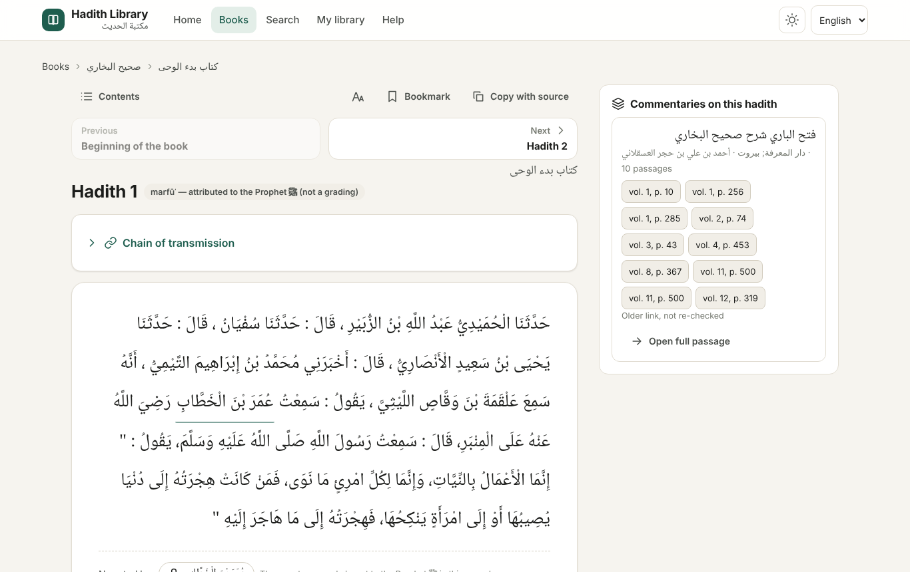
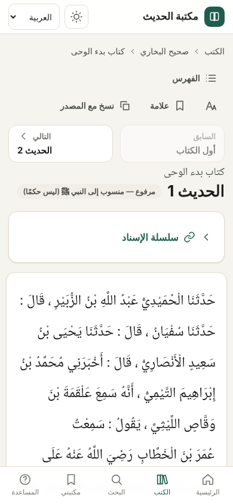
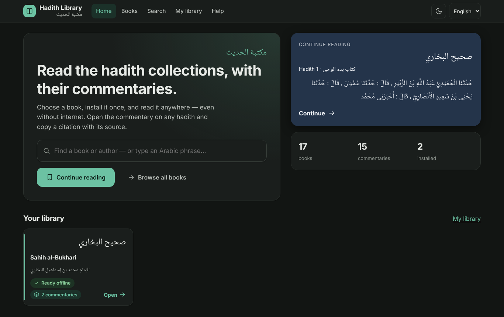

# Hadith Library | مكتبة الحديث

[العربية](README.ar.md) · [O‘zbekcha](README.uz.md)

**Read the hadith collections and their classical commentaries — offline, with sources.**

### ▶ [Open the app](https://nbeast19.github.io/vositalar/hadis-manba-platformasi/web/) · [Download books](https://github.com/Nbeast19/vositalar/releases/tag/hadis-manba-paketlar-v1) · [Quick start](docs/QUICKSTART.en.md)



1. **Open the app** and choose a book (17 collections, 15 commentaries).
2. **Install** it once — only the book, or the book with the commentaries you pick. It then works without internet.
3. **Read** in order with *Previous / Next*, jump through the contents, tap the narrator to see their other narrations, open a commentary beside the hadith, and copy a citation with its source.

- English and العربية interface (Arabic is right-to-left); light and dark themes; phone, tablet and desktop.
- Each hadith shows a plain **Source and verification** box: what was checked, what was not, and why — for that record.
- Hadith and commentary texts are shown exactly as in their sources; nothing is machine-translated.

 

**Packages:** 17 main books (Sunnah.com, shared with permission) and 15 commentaries (OpenITI, CC BY-NC-SA 4.0 — non-commercial, share-alike, attribution), each a separate download in the GitHub Release [hadis-manba-paketlar-v1](https://github.com/Nbeast19/vositalar/releases/tag/hadis-manba-paketlar-v1). A `.hmz` file is a library package: install it inside the app (*My library → Install from a file*). Packages with unknown rights are not published ([docs/RIGHTS.md](docs/RIGHTS.md)).

## Quick start

→ [docs/QUICKSTART.en.md](docs/QUICKSTART.en.md) (one page) · [docs/en/INSTALL.md](docs/en/INSTALL.md) (Windows, Mac, iPhone, Android, Linux)

**Open the app:** <https://nbeast19.github.io/vositalar/hadis-manba-platformasi/web/> · Catalogue: [English](https://nbeast19.github.io/vositalar/hadis-manba-platformasi/web/en/) · [العربية](https://nbeast19.github.io/vositalar/hadis-manba-platformasi/web/ar/)

**Packages:** 17 main books (Sunnah.com, shared with permission) and 15 commentaries (OpenITI, CC BY-NC-SA 4.0 — non-commercial, share-alike, attribution) — each a separate download in the GitHub Release [hadis-manba-paketlar-v1](https://github.com/Nbeast19/vositalar/releases/tag/hadis-manba-paketlar-v1), with `SHA256SUMS` and `RIGHTS-PAKETLAR.md` (licence, author, edition and attribution per package). Packages with unknown rights are not published; they stay local only ([docs/RIGHTS.md](docs/RIGHTS.md)).

## For advanced users (optional)

A desktop command-line tool (Python 3.10+) provides the same data model with SQLite full-text search, safe package import, rollback, an audit of source folders, a local service on `127.0.0.1` and an **MCP server** for AI clients:

```sh
pip install ".[mcp]"
hadis-manba doctor
hadis-manba install book.hmz
hadis-manba search "انما الاعمال بالنيات"
hadis-manba mcp            # MCP over STDIO — see docs/AI-ULASH.md
```

## Project layout

```
web/                 PWA (index.html, js/, sw.js) + prerendered /en/ and /ar/ catalogue pages, sitemap.xml
src/hadis_manba/     core, package format, importers, audit, publish (allowlist), site generator, MCP, CLI
tests/               pytest, Node and Playwright (English + Arabic, 1280px + 390px, offline)
docs/                guides (en, ar, uz), schema, package format, rights, coverage, validation report
```

## Three separate statuses

1. **Software:** see [docs/VALIDATION-REPORT.md](docs/VALIDATION-REPORT.md) — automated tests in headless Chromium; real devices not yet tested.
2. **Scholarly coverage:** INCOMPLETE ([docs/COVERAGE.md](docs/COVERAGE.md)).
3. **Public distribution rights:** allowlist only ([docs/RIGHTS.md](docs/RIGHTS.md)).

## Licence

Code: MIT ([LICENSE](LICENSE)). Each data package carries its own licence and attribution; the code licence grants no rights to source texts.
